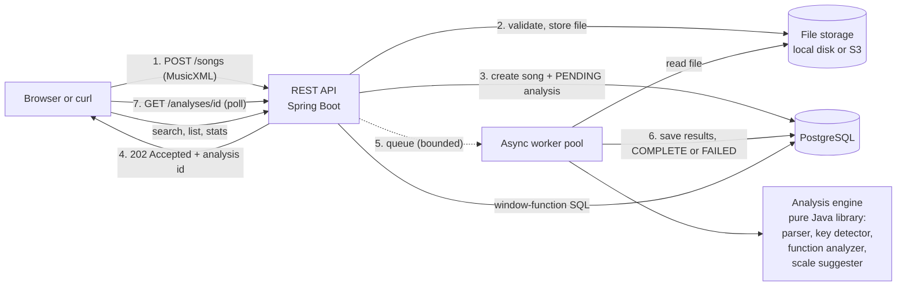
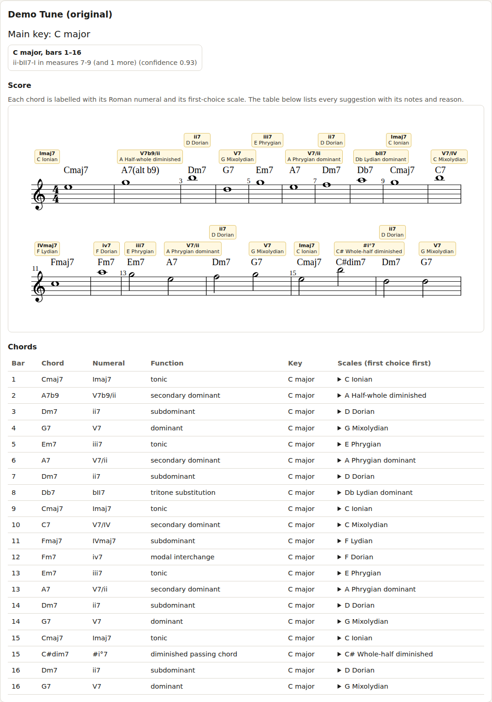
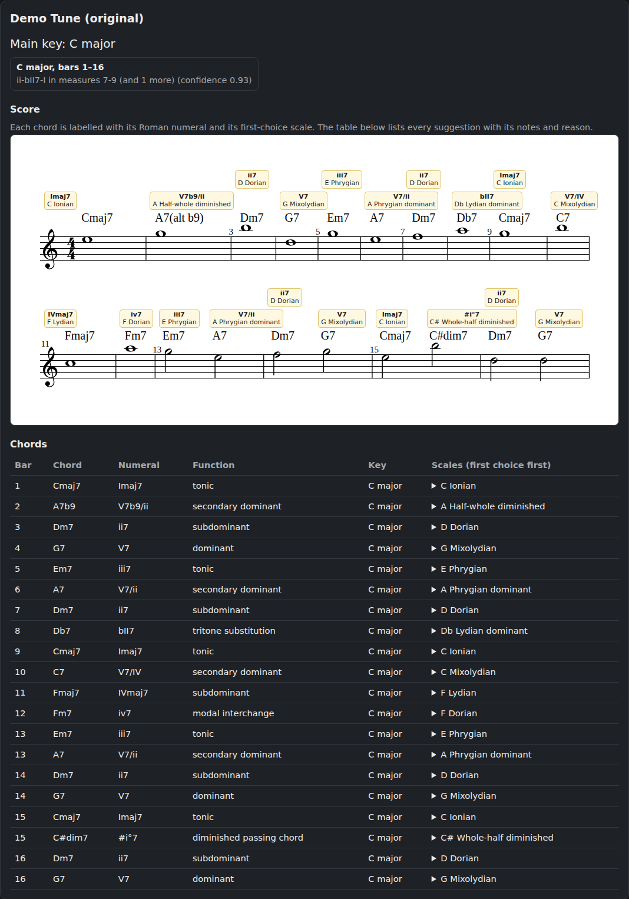

# Jazz Chart Analyzer

[](https://github.com/laveenh-source/JazzImprovHelper/actions/workflows/ci.yml)


Upload a **MusicXML jazz lead sheet** and get back:

1. the **key**, including local key changes (modulations) found from ii-V-I patterns,
2. the **function of every chord** as a Roman numeral (diatonic, secondary dominant, tritone substitution,
   diminished passing chord, borrowed chord, or honestly "unclassified"),
3. **ranked improvisation scales for each chord**, spelled correctly, each with a plain-English reason,

and **search the library** ("every tune with a ii-V-I in Bb"). Built with Java 21, Spring Boot 4, PostgreSQL,
Docker, GitHub Actions and Terraform for AWS.

> **A deliberate design choice:** this is a **rule-based music-theory engine**. There is no machine learning, no audio
> processing and no sheet-music image recognition. The rules are written down in a data file a musician can read and
> correct, every answer comes with a reason, and what the rules cannot explain is reported as unclassified instead of
> guessed. See [docs/DESIGN_DECISIONS.md](docs/DESIGN_DECISIONS.md).

## What it looks like

For `Dm7 | A7 | Dm7` in C major:

| Chord | Numeral | Function | First-choice scale | Why |
|---|---|---|---|---|
| Dm7 | ii7 | subdominant | D Dorian | standard choice over a ii chord |
| A7 | V7/ii | secondary dominant | A Phrygian dominant | resolving to a minor chord |
| Dm7 | ii7 | subdominant | D Dorian | standard choice over a ii chord |

A worked, number-by-number walkthrough of how it decides is in [docs/HOW_IT_WORKS.md](docs/HOW_IT_WORKS.md).
Try it on the included original [demo tune](docs/examples/demo-tune.xml).

## Architecture



Packages (the engine has **no Spring imports**):

```
domain/        Note, Key, Chord, ChordQuality, Scale ...                 pure Java
parser/        MusicXML -> Chart (XXE-safe)                              pure Java
analysis/      ChordClassifier, KeyDetector, FunctionAnalyzer,
               ScaleSuggester, ProgressionPattern                        pure Java, 80% coverage gate
cli/           command-line front end
api/           controllers, DTOs, one JSON error format, OpenAPI
service/       upload validation, dedupe, async processing
persistence/   JPA entities, repositories, hand-written SQL
storage/       FileStorage: local disk and S3
config/        wiring, filters (request id, rate limit, security headers)
resources/theory/   chord-kinds.properties, scale-rules.json   <- edit these to change the theory
resources/static/   the web page (OpenSheetMusicDisplay, bundled)
```

## Run it

### Everything, with one command (needs only Docker)

```bash
docker compose up --build
```

This starts the app, PostgreSQL and a local stand-in for Amazon S3 (so the app uses the same S3 code path it uses
on AWS). Then open **http://localhost:8080** (the web page) or **http://localhost:8080/swagger-ui.html** (API docs), or:

```bash
scripts/smoke-test.sh      # uploads a chart, waits for the analysis, checks the answer, searches, cleans up
```

### Development

```bash
mvn verify                 # all tests (Docker must be running: they start PostgreSQL with Testcontainers) + coverage gate
mvn spring-boot:run        # needs a local PostgreSQL: database "jazz", user "jazz", password "jazz"
mvn -q compile exec:java -Dexec.args="src/test/resources/fixtures/minor-ii-v-i.xml"    # analyse a file in the terminal
```

Settings (all have local defaults; none are secrets in git): `DB_URL`, `DB_USER`, `DB_PASSWORD`, `STORAGE_DIR`,
`SPRING_PROFILES_ACTIVE=s3` with `S3_BUCKET` / `S3_ENDPOINT` / `S3_PATH_STYLE`, `ANALYSIS_MODE`, `ANALYSIS_THREADS`,
`ANALYSIS_QUEUE`, `RATE_LIMIT_UPLOADS`, `RATE_LIMIT_REQUESTS`.

## API

Base path `/api/v1`. Errors always look like `{timestamp, status, error, message, path}`. Interactive docs at
`/swagger-ui.html`; machine-readable at `/v3/api-docs`.

| Method and path | What it does |
|---|---|
| `POST /songs` | Upload one `.xml`/`.musicxml` file (up to 2 MB). **202** with an analysis id, or **200** if that exact file was analysed before. **503** when the work queue is full. |
| `POST /songs/batch` | Upload up to 10 files; each is handled on its own and reported per file. |
| `GET /analyses/{id}` | Status (`PENDING`, `RUNNING`, `COMPLETE`, `FAILED`) and, when complete, the key regions and every chord with scales. |
| `GET /songs?page&size&sort&key` | Paginated list; sort by `title`, `uploadedAt`, `detectedKey`; filter by key. |
| `GET /songs/{id}`, `/songs/{id}/chords`, `/songs/{id}/file` | Song summary, per-chord detail, the original file (as a download). |
| `DELETE /songs/{id}` | Deletes the song, its analyses and the stored file. |
| `GET /search/progressions?pattern=ii-V-I&key=Bb` | Songs containing a progression, in which key and bars. Patterns: `ii-V-I`, `ii-V-i`, `ii-V`, `V-I`, `I-vi-ii-V`, `iii-vi-ii-V`, `ii-bII7-I`. |
| `GET /stats` | Most common chord qualities and chord-to-chord moves across the library. |
| `GET /actuator/health` | Health check (used by the load balancer). |

```bash
curl -F "file=@chart.xml" localhost:8080/api/v1/songs
# {"songId":"...","analysisId":"3f2b...","status":"PENDING","duplicate":false,"analysisUrl":"/api/v1/analyses/3f2b..."}

curl localhost:8080/api/v1/analyses/3f2b...
curl "localhost:8080/api/v1/songs?key=Bb&sort=title,asc&size=10"
curl "localhost:8080/api/v1/search/progressions?pattern=ii-V-I&key=Bb"
curl localhost:8080/api/v1/stats
curl -X DELETE localhost:8080/api/v1/songs/<songId>
```

## The music theory is data

- `src/main/resources/theory/chord-kinds.properties`: how MusicXML chord kinds map to chord qualities.
- `src/main/resources/theory/scale-rules.json`: which scales to suggest, in ranked order, with reasons. First matching
  rule wins; each rule is tagged `"origin": "spec"` or `"added"`. The file is validated at startup, so a typo fails
  loudly instead of silently doing nothing.

Fixtures in `src/test/resources/fixtures` are hand-written and tiny; no copyrighted lead sheets are in this repository.

## Results

Everything below was measured, by a script or a build in this repository; where something was **not** measured it says so.
Method, machine and caveats are in [docs/PERFORMANCE.md](docs/PERFORMANCE.md).

**Tests and coverage** (`mvn verify`: 489 tests, 0 failures; real PostgreSQL via Testcontainers; a fake S3 in Docker)

| package | line coverage |
|---|---:|
| `analysis` (key detection, functions, scales) | 99.4% |
| `domain` | 98.3% |
| all packages together | 96.4% (1,637 of 1,699 lines) |

The build fails if `domain` or `analysis` fall under 80%.

**Analysis speed**: a 32-bar chart is parsed and analysed in **0.27 ms** (median, warm JVM; p95 0.46 ms). A 256-bar chart takes 1.7 ms.

**Database** (5,000 *synthetic* songs, 328,650 chords, PostgreSQL 16 with default settings, median of 5 `EXPLAIN ANALYZE` runs):

| | before | after | what did it |
|---|---:|---:|---|
| Song list (newest 20) | 917 ms | **11 ms** | index on `analyses(song_id, created_at DESC)` |
| Delete a song (cascade) | 2,454 ms | **2.2 ms** | indexes on the foreign keys |
| Progression search, any key | 15,237 ms | **1,124 ms** | rewriting the query (no join after the window functions), **not** an index |
| Progression search, in Bb | 2,145 ms | **1,101 ms** | the same rewrite |
| An index suggested up front, `chords(quality, roman_numeral)` | | **no effect** | measured, then left out of the schema |

**Container**: the final image is 428 MB (the jar alone is 74 MB), runs as a non-root user, and holds no compiler or Maven.
`docker compose up` brings up the app, PostgreSQL and an S3 stand-in, and `scripts/smoke-test.sh` passes against it.

**Not measured**: HTTP load or concurrency (no load test was run), the AWS deployment (never applied to an account), and
real, non-synthetic libraries.

Screenshots of the web page (original demo tune, `docs/examples/demo-tune.xml`):

| light | dark |
|---|---|
|  |  |


## Limits, honestly

- Rule-based: it only knows the patterns it was given. Unexplained chords are labelled unclassified.
- Confidence numbers are heuristic scores, not probabilities.
- Compressed `.mxl` files are not supported yet. There is **no authentication**: the API is open.
- The AWS deployment is written and validated (`terraform validate`) but **has not been applied to a real account**
  yet, so there is no live demo link. See [docs/AWS_DEPLOYMENT.md](docs/AWS_DEPLOYMENT.md) for what that means.

## Documentation

- [How the analyzer works, step by step](docs/HOW_IT_WORKS.md)
- [Design decisions](docs/DESIGN_DECISIONS.md)
- [Performance measurements](docs/PERFORMANCE.md)
- [AWS deployment, costs and teardown](docs/AWS_DEPLOYMENT.md)
